# System Architecture — Quantamental AI

**Author:** Senior Quantitative Developer, Financial Engineer & Software Architect
**Project:** Quantamental AI (AI-Augmented Portfolio Optimization & Financial Risk Intelligence)
**Target Market:** Indian Equities (National Stock Exchange - NSE)
**Status:** Architecture Specification — Canonical Sign-off Edition (Approved Decisions)
**Version:** 1.4.0

---

## 1. Project Overview

Quantamental AI is a **quantitative finance research and decision-support platform** engineered specifically for Indian equities listed on the National Stock Exchange (NSE). The platform establishes a strict architectural separation between **deterministic financial mathematics** and **probabilistic statistical learning models**.

```
+-----------------------------------------------------------------------------------+
|                                 QUANTAMENTAL AI                                   |
|                                                                                   |
|   +-------------------------------+       +-----------------------------------+   |
|   |   Deterministic Core          |       |   Probabilistic AI Engine         |   |
|   |   (Modern Portfolio Theory)   |       |   (Staged Machine & Deep Learning)   |   |
|   |                               |       |                                   |   |
|   | - Markowitz Mean-Variance     |       | [Approved Staged Core Scope]      |   |
|   | - SLSQP Quadratic Solver      | <---  | Stage 1: Historical Vol Baseline  |   |
|   | - Sample, Sklearn Ledoit-Wolf |   |   | Stage 2: XGBoost Vol Forecaster   |   |
|   | - Constant-Correlation Shrink |   |   | Stage 3: PyTorch LSTM Sequence    |   |
|   | - Listwise-Aligned Default    |   |   | Stage 4: Filtered Gaussian HMM    |   |
|   | - Condition & PD Checks (>0)  |   |   | - Anti-Leakage / Lagged Features  |   |
|   | - Higham Standardization/Scale|   |   |                                   |   |
|   | - Dual PyPortfolioOpt Audit   |   |   | [Optional Research Extensions]    |   |
|   +---------------+---------------+   |   | - GARCH(1,1), GRU, TCN, Adv. HMM  |   |
|                   |                   |   |                                   |   |
|                   v                   |   |                                   |   |
|   +-----------------------------------+---+-----------------------------------+   |
|   |             Event-Driven Historical Backtesting & Execution Engine        |   |
|   |     Configurable Date-Aware Indian Friction: STT, Stamp, SEBI, Slippage   |   |
|   +---------------------------------------------------------------------------+   |
+-----------------------------------------------------------------------------------+
```

### 1.1 Architectural Philosophy
1. **Mathematical Determinism First:** All classical portfolio theory calculations (covariance matrices, expected returns, Efficient Frontier, Sharpe maximization, VaR/CVaR) are deterministic, mathematically verified, and audited for constraint satisfaction and objective parity. The platform avoids promising perfect numerical or investment outcomes.
2. **Strict Isolation of ML/AI Models:** Predictive machine learning and deep learning models are strictly probabilistic. The deterministic financial engine **never** relies on ungrounded heuristic outputs. AI predictions act strictly as inputs (e.g., regime indicators, forecasted volatility adjustments) into bounded, constrained mathematical optimizers.
3. **Anti-Leakage Temporal Design:** All feature extraction, normalizations, model trainings, market regime inferences, and portfolio weights adhere to explicit anti-leakage design requirements and reproducible validation tests:
   $$\text{Decision at time } t \iff \text{Information available strictly at } \tau \le t - 1 \text{ (or pre-open } t\text{)}$$
   In market regime detection, only **filtered probabilities** $P(S_t \mid y_{1:t})$ are permitted during backtesting. Smoothed probabilities $P(S_t \mid y_{1:T})$ are strictly forbidden in historical trading decisions.
4. **Empirical Realism:** No idealized assumptions of frictionless markets. Backtests incorporate date-aware, configurable Indian equity microstructure components: Securities Transaction Tax (STT), exchange turnover charges, SEBI turnover fees, GST, stamp duty, and asset-specific slippage.
5. **Persistent Historical Retention & Dynamic Rolling Research Window:** The system preserves previously collected historical observations in persistent storage and executes incremental refreshes. Research and optimization modules dynamically slice a rolling five-year window ending at the latest available completed trading session, recording exact window boundaries and data snapshot hashes for reproducibility-supporting auditability.

---

## 2. Complete System Architecture

Quantamental AI follows a decoupled client-server architecture designed for high numerical performance, reproducibility, and interactive data visualization.

```mermaid
flowchart TD
    subgraph ClientLayer ["Client Layer (Frontend)"]
        UI["React 18 + Vite SPA"]
        PlotlyEngine["Plotly.js Interactive Visualizers<br/>(Efficient Frontier, Drawdown, Heatmaps)"]
        RechartsEngine["Recharts Component Dashboards<br/>(Allocation Bars, Time Series)"]
        StateStore["Zustand State Store + React Query Cache"]
        UI --> PlotlyEngine
        UI --> RechartsEngine
        UI --> StateStore
    end

    subgraph APILayer ["API & Gateway Layer (Backend)"]
        FastAPIApp["FastAPI Application (Python 3.11+)"]
        PydanticSchemas["Pydantic v2 Request/Response Validation"]
        AuthMiddleware["Security & Rate Limiting Middleware"]
        FastAPIApp --> PydanticSchemas
        FastAPIApp --> AuthMiddleware
    end

    subgraph FinancialCore ["Deterministic Financial Calculation Engine"]
        ReturnsEngine["Returns & Statistical Moments Engine"]
        CovEngine["Covariance Estimators<br/>(Listwise Default, Sklearn Ledoit-Wolf, Constant-Correlation)"]
        PSDCorrector["PD & Condition Projector<br/>(Standardize -> Higham -> Rescale -> PD Check)"]
        CustomOptimizer["SLSQP Custom Constrained Optimizer<br/>(Default: RAISE_EXCEPTION, Configurable Fallback)"]
        PyPoptValidator["PyPortfolioOpt Dual-Solver Auditor"]
        MonteCarloEngine["Vectorized Monte Carlo Simulator"]
        RiskEngine["VaR / CVaR / Downside Risk Engine"]

        ReturnsEngine --> CovEngine
        CovEngine --> PSDCorrector
        PSDCorrector --> CustomOptimizer
        PSDCorrector --> PyPoptValidator
        CustomOptimizer <-->|Feasibility & Objective Audit| PyPoptValidator
        ReturnsEngine --> MonteCarloEngine
        ReturnsEngine --> RiskEngine
    end

    subgraph AIEngine ["AI Risk & Intelligence Lab (Staged)"]
        FeatureStore["Anti-Leakage Feature Pipeline (Lagged tau <= t-1)"]
        WalkForwardSplitter["Walk-Forward Chronological Splitter"]
        Stage1["Stage 1: Historical Volatility Baseline"]
        Stage2["Stage 2: XGBoost Volatility Regressor"]
        Stage3["Stage 3: PyTorch LSTM Sequence Model"]
        Stage4["Stage 4: Filtered Gaussian HMM Regime Classifier"]
        ShapEngine["TreeSHAP Explainability Engine"]

        FeatureStore --> WalkForwardSplitter
        WalkForwardSplitter --> Stage1
        Stage1 -->|Gate 1 Passed| Stage2
        Stage2 -->|Gate 2 Passed| Stage3
        Stage3 -->|Gate 3 Passed| Stage4
        Stage2 --> ShapEngine
    end

    subgraph BacktestEngine ["Research & Backtesting Lab"]
        SimulationLoop["Discrete Historical Rebalance Engine"]
        IndianCostModel["Configurable Date-Aware Friction Model<br/>(STT, Stamp, Exchange, SEBI, GST, Slippage)"]
        BenchmarkAuditor["Benchmark Engine (Nifty 50 TRI Preferred / Price Index Labeled)"]
        SimulationLoop --> IndianCostModel
        SimulationLoop --> BenchmarkAuditor
    end

    subgraph DataStorageLayer ["Data Lifecycle & Storage Layer"]
        DataProvider["BaseDataProvider Abstract Interface"]
        YFinanceAdapter["YFinance Ingestion Adapter (Normalized Schema)"]
        IncrementalEngine["Incremental Refresh & Overlap Reconciliation Engine"]
        AuditReconciler["Periodic Full Historical Audit & Version Checker"]
        LocalParquet["Persistent Parquet Historical Store (Local Dev)"]
        CloudStorage["S3 / Cloud Object Store (Production Artifacts)"]
        SupabasePG["Supabase PostgreSQL DB<br/>(Portfolios, Backtests, Model Metadata, Refresh Logs)"]

        DataProvider --> YFinanceAdapter
        YFinanceAdapter --> IncrementalEngine
        IncrementalEngine --> AuditReconciler
        IncrementalEngine --> LocalParquet
        IncrementalEngine --> CloudStorage
        IncrementalEngine --> SupabasePG
    end

    %% Cross-layer links
    StateStore <==>|HTTP / REST JSON| FastAPIApp
    FastAPIApp --> FinancialCore
    FastAPIApp --> AIEngine
    FastAPIApp --> BacktestEngine
    FinancialCore <--> LocalParquet
    AIEngine <--> LocalParquet
    BacktestEngine <--> FinancialCore
    BacktestEngine <--> AIEngine
    FastAPIApp <--> SupabasePG
```



### 2.1 Communication, Execution Flows & Benchmark Performance Targets
- **Synchronous Computation Path & Latency Targets:** Parameterized Markowitz optimizations, covariance evaluations, and single-window portfolio metrics execute synchronously via vectorized NumPy/SciPy operations.
  - *Benchmark Target:* Targeting median latency $p50 < 300\text{ ms}$ and $p95 < 500\text{ ms}$ on standard developer-class hardware (modern 4-core x86_64 or Apple Silicon CPU) for a 10-asset universe over a 5-year daily series (~1,250 observations).
- **Asynchronous / Cached Path:** Multi-path Monte Carlo simulations (100,000+ paths), multi-year walk-forward backtests, and deep learning model training execute asynchronously via background tasks or cached pre-computed artifacts.
- **Client Cache Strategy:** React Query (`@tanstack/react-query`) manages client-side caching with explicit stale-time and cache invalidation policies to eliminate redundant server calculations.

---

## 3. Repository Folder Structure

The repository utilizes a modular, clean-architecture pattern separating frontend, backend, documentation, and data assets:

```
quantamental-ai/
├── README.md                           # Original project README (untouched)
├── ARCHITECTURE.md                     # This complete architectural specification
├── docs/                               # Formal architectural documentation
│   ├── PROJECT_PLAN.md                 # Detailed milestone roadmap and task breakdown
│   ├── FINANCIAL_METHODOLOGY.md        # Mathematical formulas, proofs, and edge cases
│   └── DATA_STRATEGY.md                # Data ingestion, schema, corporate actions & licensing
├── backend/                            # Python FastAPI backend service
│   ├── pyproject.toml                  # Standard Python packaging (pip + venv)
│   ├── Dockerfile                      # Production Docker container definition
│   ├── app/
│   │   ├── __init__.py
│   │   ├── main.py                     # FastAPI application factory and lifespan setup
│   │   ├── config.py                   # Pydantic BaseSettings (env vars, constants)
│   │   ├── core/                       # Core system utilities, logging, exceptions
│   │   │   ├── exceptions.py
│   │   │   └── logger.py
│   │   ├── api/                        # API route controllers
│   │   │   ├── __init__.py
│   │   │   ├── dependencies.py         # FastAPI dependency injection
│   │   │   └── v1/
│   │   │       ├── router.py           # v1 Route aggregator
│   │   │       ├── endpoints/
│   │   │       │   ├── data.py         # Asset metadata, price series, and refresh logs
│   │   │       │   ├── optimization.py # Module A: Classical portfolio optimizer
│   │   │       │   ├── ai_lab.py       # Module B: Machine learning & regime detection
│   │   │       │   └── backtest.py     # Module C: Backtesting and performance attribution
│   │   ├── schemas/                    # Pydantic v2 data validation schemas
│   │   │   ├── common.py               # Shared request/response wrappers
│   │   │   ├── data_schemas.py
│   │   │   ├── optimization_schemas.py
│   │   │   ├── ai_schemas.py
│   │   │   └── backtest_schemas.py
│   │   ├── financial_engine/           # Module A: Deterministic Quantitative Finance
│   │   │   ├── __init__.py
│   │   │   ├── returns.py              # Log/simple returns, compounding, annualized metrics
│   │   │   ├── covariance.py           # Listwise default, Sklearn Ledoit-Wolf, Constant-Correlation
│   │   │   ├── psd_projection.py       # Condition checks, eigenvalue clipping, Higham algorithm
│   │   │   ├── optimizer.py            # SLSQP custom solver (Min Var, Max Sharpe, Target Return)
│   │   │   ├── validator.py            # PyPortfolioOpt shadow validation auditor
│   │   │   ├── frontier.py             # Efficient Frontier & Capital Allocation Line (CAL)
│   │   │   ├── monte_carlo.py          # Vectorized Monte Carlo simulation generator
│   │   │   └── risk_metrics.py         # Historical/Parametric VaR, CVaR, Drawdown, Sortino
│   │   ├── ai_engine/                  # Module B: Predictive ML & Regime Intelligence
│   │   │   ├── __init__.py
│   │   │   ├── feature_pipeline.py     # Anti-leakage lagged technical/statistical features (tau <= t-1)
│   │   │   ├── splitters.py            # Walk-forward chronological time-series splitters
│   │   │   ├── baselines.py            # Stage 1: Historical Volatility & Mean Baselines, Ridge/OLS
│   │   │   ├── tree_models.py          # Stage 2: XGBoost Volatility Regressor & LightGBM/RF
│   │   │   ├── deep_models/            # PyTorch Deep Learning Architectures
│   │   │   │   ├── lstm.py             # Stage 3: Long Short-Term Memory network
│   │   │   │   ├── gru.py              # Optional Extension: Gated Recurrent Unit
│   │   │   │   └── tcn.py              # Optional Extension: Temporal Convolutional Network
│   │   │   ├── volatility.py           # Historical Volatility, XGBoost Vol, and GARCH (Optional)
│   │   │   ├── regime_detection.py     # Stage 4: Gaussian HMM (Filtered probabilities, post-hoc)
│   │   │   └── explainability.py       # TreeSHAP explainability pipeline
│   │   ├── backtest_engine/            # Module C: Portfolio Research & Backtesting Lab
│   │   │   ├── __init__.py
│   │   │   ├── simulator.py            # Historical step-by-step rebalance simulation engine
│   │   │   ├── cost_model.py           # Configurable date-aware Indian transaction costs
│   │   │   ├── benchmark.py            # Nifty 50 TRI / Price Index integration
│   │   │   └── performance.py          # Daily Sharpe, Sortino (MAR), CAGR, MDD, Turnover
│   │   ├── data_engine/                # Data Ingestion, Storage & Cleansing
│   │   │   ├── __init__.py
│   │   │   ├── base.py                 # Abstract Base Class for Data Providers
│   │   │   ├── yfinance_provider.py    # Yahoo Finance adapter (normalized schema)
│   │   │   ├── calendar.py             # Official NSE trading calendar manager
│   │   │   ├── clean_pipeline.py       # Normalization, missing-data policies, audit gates
│   │   │   ├── incremental.py          # Incremental fetcher with recent overlap reconciliation
│   │   │   ├── reconciliation.py       # Periodic broader historical revision auditor
│   │   │   └── storage.py              # Parquet cache manager and Supabase synchronizer
│   │   └── db/                         # PostgreSQL Persistence Layer
│   │       ├── session.py              # SQLAlchemy 2.0 async engine and sessionmaker
│   │       └── models.py               # SQLAlchemy ORM declarative models
│   └── tests/                          # Automated PyTest suite
│       ├── conftest.py                 # Shared fixtures, synthetic test matrices
│       ├── unit/
│       │   ├── test_financial_math.py  # 2-asset closed-form proof tests
│       │   ├── test_covariance.py      # Listwise vs Pairwise, Ledoit-Wolf condition checks
│       │   ├── test_psd.py             # Higham standardization/rescaling vs clipping tests
│       │   ├── test_optimizer.py       # SLSQP convergence, feasibility, fallback handling
│       │   ├── test_validation.py      # Custom vs PyPortfolioOpt scale-aware objective audit
│       │   ├── test_leakage.py         # Anti-leakage tests asserting strictly tau < t
│       │   ├── test_hmm_filtered.py    # Filtered probabilities test in backtesting
│       │   └── test_cost_model.py      # Date-aware Indian tax and fee tests
│       └── integration/
│           ├── test_api_endpoints.py   # FastAPI HTTP status and response schema tests
│           └── test_data_pipeline.py   # Incremental refresh, overlap, and upsert tests
├── frontend/                           # React + Vite frontend application
│   ├── package.json
│   ├── vite.config.ts
│   ├── tsconfig.json
│   ├── src/
│   │   ├── main.tsx
│   │   ├── App.tsx
│   │   ├── routes.tsx
│   │   ├── api/                        # Typed Axios / Fetch API clients
│   │   ├── components/                 # Reusable UI component library
│   │   │   ├── common/                 # Buttons, Cards, Inputs, Loaders, Tooltips
│   │   │   ├── charts/                 # Plotly & Recharts wrappers
│   │   │   │   ├── EfficientFrontierChart.tsx
│   │   │   │   ├── CorrelationHeatmap.tsx
│   │   │   │   ├── EquityCurveChart.tsx
│   │   │   │   ├── DrawdownChart.tsx
│   │   │   │   ├── RegimeTimelineChart.tsx
│   │   │   │   └── ShapSummaryChart.tsx
│   │   │   └── layout/                 # Navbar, Sidebar, PageContainer
│   │   ├── pages/                      # Lab Views
│   │   │   ├── ClassicalLabPage.tsx    # Module A: Classical Portfolio Optimization
│   │   │   ├── AIRiskLabPage.tsx       # Module B: AI Risk & Volatility Intelligence
│   │   │   ├── BacktestLabPage.tsx     # Module C: Portfolio Backtest & Research
│   │   │   └── DataExplorerPage.tsx    # Historical Asset Inspector & Diagnostics
│   │   ├── hooks/                      # Custom React hooks (useOptimization, useBacktest)
│   │   └── types/                      # TypeScript definitions mirroring Pydantic schemas
└── storage/                            # Local development persistent cache (git-ignored)
    ├── parquet/                        # Partitioned daily OHLCV Parquet files
    └── models/                         # Serialized ML checkpoints (.pt, .joblib)
```

---

## 4. Backend Module Responsibilities

### 4.1 Ingestion & Cleansing Layer (`app/data_engine/`)
- Implements `BaseDataProvider` interface.
- Normalizes corporate actions and provider payloads using provider-agnostic schemas:
  - When `auto_adjust=False`: maps nominal OHLC and `Adj Close` separately when available.
  - When `auto_adjust=True`: explicitly records that nominal OHLC is not provided; **never** populates nominal fields with adjusted prices.
  - Captures retrieval metadata, provider identifier, adjustment mode, and validation status.
  - Corporate action values (`split_factor`, `dividend_amount`) are **never** inferred from adjusted OHLC alone.
- Synchronizes dates against official NSE trading calendars (seeded from exchange holiday circulars and updated annually upon publication of the upcoming calendar).
- Manages **persistent historical retention** (never deleting past data) and executes **incremental updates** with a configurable overlap period (5–10 trading days) to reconcile recent provider revisions.
- Implements a documented **periodic broader historical reconciliation strategy** to capture deep historical restatements while preserving snapshot versioning for backtest auditability.
- Slices the active rolling five-year window dynamically from the persistent historical store.
- Enforces configurable, asset-specific missing-data policies (distinguishing warnings, exclusions, and quarantine; separate rules for valuation, returns, risk, ML, and backtesting; strictly no `bfill`).

### 4.2 Deterministic Financial Engine (`app/financial_engine/`)
- Computes simple returns for portfolio aggregation and log returns for time-series modeling.
- **Covariance Estimation Strategy:**
  - For the initial 10-stock MVP, **prefers a common aligned observation window using listwise-complete observations** (dropping dates where any constituent asset lacks a valid tick), ensuring a mathematically consistent inner product.
  - Notes that pairwise-complete estimation can produce a non-positive-semidefinite (non-PSD) matrix. If pairwise estimation is enabled, it explicitly validates strict positive definiteness ($\lambda_{min} > 0$) and condition number. If validation fails, Higham's standardized correlation projection is applied; if the condition number remains severely degenerate, the matrix is rejected with diagnostic logging.
  - Implements three estimators: Sample covariance, standard `sklearn.covariance.LedoitWolf` (scaled-identity target), and Constant-Correlation shrinkage (Ledoit-Wolf 2004). Recognizes that shrinkage generally improves conditioning but requires explicit eigenvalue and condition number checks.
- Solves constrained quadratic programming problems using SciPy `SLSQP` with analytical gradients, validating constraint satisfaction and scale-aware objective parity against `PyPortfolioOpt`.
- Implements explicit, configurable fallback handling (`RAISE_EXCEPTION`, `EQUAL_WEIGHT`, `PREVIOUS_WEIGHT`, `HOLD_CASH`), recording solver failure reasons and validation status without silent substitution. **`RAISE_EXCEPTION` is the approved default optimizer fallback for research and optimization.**

### 4.3 AI & Risk Intelligence Engine (`app/ai_engine/`)
- Constructs strictly lagged feature sets ($\tau \le t - 1$) verified by anti-leakage test suites.
- Implements the approved core scope across **staged validation gates**:
  - **Stage 1:** Historical Volatility & Rolling Mean Baselines (establishing reference error benchmarks).
  - **Stage 2:** XGBoost Regressor for forward realized volatility forecasting (evaluated against Stage 1).
  - **Stage 3:** PyTorch LSTM Deep Sequence Model (sequential feature representations evaluated against Stage 2).
  - **Stage 4:** Gaussian Hidden Markov Model (HMM) with post-hoc parameter labeling and strictly **filtered probabilities** during historical backtesting.
- Generates TreeSHAP feature attributions for XGBoost.
- Labels advanced models (GARCH, GRU, TCN, higher-order HMM) as optional research extensions.

### 4.4 Backtesting & Attribution Engine (`app/backtest_engine/`)
- Simulates periodic rebalancing with explicit 1-period execution latency (Close $t-1 \to$ Open/Close $t$).
- Applies configurable, date-aware Indian transaction costs (statutory STT, stamp duty, exchange turnover charges, SEBI fees, brokerage, GST, and volume slippage).
- Computes conventional daily-excess-return Sharpe ratio:
  $$\text{Sharpe} = \sqrt{252} \cdot \frac{\text{mean}(R_{p, t} - r_{f, daily})}{\text{std}(R_{p, t} - r_{f, daily})}$$
- Computes Sortino ratio using an explicit Minimum Acceptable Return (MAR, default $r_{f, daily}$) in both numerator and denominator.
- Reports CAGR as a separate multi-period realized growth metric.
- Compares performance against Nifty 50 TRI (preferred subject to data licensing) or documented Nifty 50 price index accurately labeled.

---

## 5. Frontend Module Responsibilities

### 5.1 Architecture & State Management
- Built with **React 18**, **TypeScript**, and **Vite**.
- State partitioned into React Query (server-state caching and deduplication) and Zustand (client UI selections: universe tickers, rebalance schedule, risk-free rate, optimization targets, fallback preferences).

### 5.2 Laboratory Views
- **Module A UI (Classical Optimization):** Plotly Efficient Frontier chart (Monte Carlo cloud, continuous frontier line, CAL, GMV, and Tangency points), asset allocation donut/stacked charts, covariance/correlation heatmaps, tail risk scorecard, and clear indicators if an optimizer fallback was executed.
- **Module B UI (AI Risk Lab):** Staged model leaderboard comparing baseline vs XGBoost vs LSTM on out-of-sample data; HMM regime timeline overlay on Nifty 50; volatility forecast comparison; SHAP summary and waterfall plots.
- **Module C UI (Backtesting Lab):** Comparative equity curves (Strategy vs Benchmark vs 1/N); drawdown underwater charts; historical rebalance ledger showing asset weights, turnover, transaction fees, and data snapshot versions.

---

## 6. Financial Engine Architecture & Validation Framework

### 6.1 Classical Markowitz Optimization Formulation
Let $N$ be the number of assets. Let $\mathbf{w} \in \mathbb{R}^N$ be the weight vector. Let $\boldsymbol{\mu}_{ann} \in \mathbb{R}^N$ be the annualized arithmetic expected return vector. Let $\boldsymbol{\Sigma}_{ann} \in \mathbb{R}^{N \times N}$ be the positive definite annualized covariance matrix. Let $r_{f, ann}$ be the annualized risk-free rate.

**1. Minimum Variance Portfolio:**
$$\min_{\mathbf{w}} \quad \frac{1}{2} \mathbf{w}^T \boldsymbol{\Sigma}_{ann} \mathbf{w} \quad \text{s.t.} \quad \mathbf{1}^T \mathbf{w} = 1, \quad 0 \le w_i \le 1$$

**2. Maximum Sharpe Ratio Portfolio (Tangency Portfolio):**
The optimizer minimizes the negative Sharpe ratio using consistently annualized metrics and numerical stability constant $\epsilon = 10^{-10}$:
$$\min_{\mathbf{w}} \quad - \frac{\mathbf{w}^T \boldsymbol{\mu}_{ann} - r_{f, ann}}{\sqrt{\mathbf{w}^T \boldsymbol{\Sigma}_{ann} \mathbf{w} + \epsilon}} \quad \text{s.t.} \quad \mathbf{1}^T \mathbf{w} = 1, \quad 0 \le w_i \le 1$$
Analytical Jacobians are provided to SciPy `SLSQP` to improve gradient precision and avoid finite-difference truncation errors:
$$\nabla_{\mathbf{w}} g(\mathbf{w}) = - \left[ \frac{\boldsymbol{\mu}_{ann}}{\sigma_p(\mathbf{w})} - \frac{(\mathbf{w}^T \boldsymbol{\mu}_{ann} - r_{f, ann}) \boldsymbol{\Sigma}_{ann} \mathbf{w}}{\sigma_p(\mathbf{w})^3} \right]$$
While analytical gradients significantly accelerate convergence, they do not unconditionally guarantee superlinear convergence across non-convex or ill-conditioned topologies.

### 6.2 Dual-Solver Validation & Calibrated Numerical Tolerances
Tolerances are not treated as universal constants across all asset universes or time horizons; they are treated as **illustrative initial defaults that must be calibrated against representative test datasets and solver behavior during implementation testing**:
- **Constraint Satisfaction:** Strict tolerance $|\sum w_i - 1.0| \le 10^{-6}$ and $-10^{-8} \le w_i \le 1.0 + 10^{-8}$.
- **Scale-Aware Objective Parity:** Evaluated using combined absolute and relative tolerances:
  $$|\text{Obj}^{custom} - \text{Obj}^{pypopt}| \le \text{tol}_{abs} + \text{tol}_{rel} \cdot |\text{Obj}^{pypopt}|$$
  - *Variance Objectives (GMV, Frontier):* Illustrative defaults: $\text{tol}_{abs} = 10^{-5}$, $\text{tol}_{rel} = 10^{-4}$ (for variance scale $\sim 10^{-4}$ to $10^{-2}$).
  - *Sharpe Ratio Objectives:* Illustrative defaults: $\text{tol}_{abs} = 10^{-4}$, $\text{tol}_{rel} = 10^{-4}$ (for Sharpe scale $\sim 0.5$ to $2.0$).
- **Solver Convergence Status:** Verification that solver termination codes indicate genuine convergence.
- **Feasibility & Stability:** Sensitivity tests across slight initialization perturbations.
- **Weight Parity:** Evaluated only when the problem is strictly convex and the covariance matrix is strictly positive definite (unique theoretical solution).

### 6.3 Handling Degenerate Matrices & Positive Definite Projection
1. **Distinction Between PSD and PD:**
   - **Positive Semi-Definite (PSD):** $\lambda_{min} \ge 0$. Allows zero eigenvalues (singular matrix).
   - **Strictly Positive Definite (PD):** $\lambda_{min} > 0$. Necessary for strictly convex quadratic objectives and unique optimal portfolios. The engine enforces $\lambda_{min} \ge \epsilon_{pd} = 10^{-7}$.
2. **Comprehensive Higham (2002) Projection & Positive-Definite Regularization Procedure:**
   Higham's nearest correlation matrix algorithm operates strictly on correlation matrices (symmetric matrices with unit diagonal). To project an empirical or ill-conditioned covariance matrix $\boldsymbol{\Sigma} \in \mathbb{R}^{N \times N}$ onto the cone of strictly positive definite covariance matrices while preserving individual asset variances, the engine executes a strict six-step pipeline:
   1. **Pre-Standardization Variance Validation & Asset Quarantine:** Validate that all diagonal variance elements are finite and strictly positive: $\sigma_i^2 = \boldsymbol{\Sigma}_{ii} > 0$ and $\text{isfinite}(\sigma_i^2)$ for all $i$. Zero-variance (frozen price), negative-variance, or non-finite assets are quarantined or excluded prior to standardization, preventing division by zero in $\mathbf{D}^{-1/2}$.
   2. **Standardization to Correlation:** Compute $\mathbf{C} = \mathbf{D}^{-1/2} \boldsymbol{\Sigma} \mathbf{D}^{-1/2}$, where $\mathbf{D} = \text{diag}(\boldsymbol{\Sigma})$.
   3. **Higham Alternating Dykstra Projection:** Apply Higham's (2002) alternating projection algorithm to $\mathbf{C}$, yielding the nearest positive semi-definite correlation matrix $\mathbf{C}_{proj} = \text{Higham}(\mathbf{C})$.
   4. **Controlled Positive-Definite Regularization (Eigenvalue Floor & Renormalization):** Because $\mathbf{C}_{proj}$ may lie on the boundary with singular zero eigenvalues ($\lambda_{min} = 0$), apply an explicit eigenvalue floor $\tilde{\boldsymbol{\Lambda}} = \text{diag}(\max(\lambda_i, 10^{-7}))$ to spectral decomposition $\mathbf{V} \boldsymbol{\Lambda} \mathbf{V}^T$, forming $\tilde{\mathbf{C}} = \mathbf{V} \tilde{\boldsymbol{\Lambda}} \mathbf{V}^T$, followed by diagonal renormalization $\mathbf{C}_{reg} = \text{diag}(\tilde{\mathbf{C}})^{-1/2} \tilde{\mathbf{C}} \text{diag}(\tilde{\mathbf{C}})^{-1/2}$ to restore exact unit diagonals.
      - *Numerical Impact:* Introduces a controlled spectral shift $\sim 10^{-7}$ along degenerate directions while ensuring $C_{reg, ii} \equiv 1.0$, guaranteeing non-singular quadratic programming Hessians without distorting cross-asset correlation structure.
   5. **Rescaling to Covariance:** Rescale using original standard deviations: $\boldsymbol{\Sigma}_{reg} = \mathbf{D}^{1/2} \mathbf{C}_{reg} \mathbf{D}^{1/2}$. Because $\mathbf{C}_{reg}$ has exact unit diagonals, original asset variances are preserved identically: $\boldsymbol{\Sigma}_{reg, ii} = \sigma_i^2$.
   6. **Post-Rescaling Multi-Criteria Validation & Rejection Gate:** Assert symmetry ($\|\boldsymbol{\Sigma}_{reg} - \boldsymbol{\Sigma}_{reg}^T\|_\infty \le 10^{-12}$), diagonal variance preservation ($\max_i |\boldsymbol{\Sigma}_{reg, ii} - \sigma_i^2| / \sigma_i^2 \le 10^{-6}$), minimum eigenvalue ($\lambda_{min} \ge 10^{-7}$), and condition number ($\kappa < 10^6$).
      - *Rejection Gate:* If any assertion fails, **the matrix is rejected and a `CovarianceValidationError` is raised**. It is **never** silently passed to the optimizer.
3. **Approved Optimizer Fallback Policy (Default: `RAISE_EXCEPTION`):**
   When numerical optimization fails to converge or inputs are severely degenerate:
   - The engine logs the specific failure reason (e.g. `SINGULAR_COVARIANCE`, `ITERATION_LIMIT_EXCEEDED`).
   - The system executes the configured fallback policy:
     - **`RAISE_EXCEPTION` (Approved Default):** Aborts the optimization and raises a detailed error with matrix diagnostic state.
     - `EQUAL_WEIGHT`: Allocates $w_i = 1/N$.
     - `PREVIOUS_WEIGHT`: Retains portfolio weights from the prior valid period.
     - `HOLD_CASH`: Allocates 100% to cash.
   - The API response and UI explicitly flag `fallback_executed: true`, naming the selected fallback and detailing the failure cause. Silent substitution is strictly prohibited.

---

## 7. Data Ingestion, Incremental Lifecycle & Normalized Schema

### 7.1 Provider-Agnostic Normalized Schema
- **When `auto_adjust=False`:** Raw nominal prices (`open_nominal`, `high_nominal`, `low_nominal`, `close_nominal`) and `adj_close` are mapped separately when available.
- **When `auto_adjust=True`:** The engine explicitly documents that nominal OHLC is not provided in that payload; it **never** populates nominal fields with adjusted prices.
- **Corporate Action Values:** `split_factor` and `dividend_amount` are **never** inferred from adjusted OHLC alone; they are captured only from dedicated corporate action streams or verified regulatory filings.
- **Metadata:** Every stored record includes `data_provider`, `adjustment_mode`, retrieval timestamp, and corporate-action validation status.
- **Missing Field Behavior:** If expected provider fields are missing, the pipeline logs a validation error and halts or falls back based on configuration.

### 7.2 Incremental Fetching & Broader Historical Reconciliation
- **Recent Overlap Reconciliation:** Incremental refreshes fetch missing data starting `Overlap_Days` (configurable, default: 5–10 trading days) prior to the latest stored date to reconcile recent revisions and settlement updates.
- **Documented Broader Historical Reconciliation:** The system implements a **periodic broader historical reconciliation strategy** (e.g., quarterly full-history checksums or triggered version audits) to capture deep retroactive restatements.
- **Reproducibility-Supporting Controls:** When historical records are revised, previous experiment snapshots are preserved with immutable version hashes to ensure past backtests remain auditable and reproducible.

### 7.3 Configurable Missing-Data Policies
- **Context-Aware Quality Assessment:** Evaluates asset listing dates, legitimate exchange holidays, trading suspensions, and temporary provider outages before classifying missing data.
- **Tri-Level Decision Hierarchy:**
  1. *Warning Level:* Minor gaps below asset threshold generate diagnostic warnings in audit logs without halting execution.
  2. *Exclusion Level:* If an asset lacks sufficient aligned history for a specific estimation window, it is excluded from that specific calculation with clear logging.
  3. *Quarantine Level:* Severe anomalies or prolonged unexplained trading halts trigger quarantine status requiring user inspection.
- **Domain Policies:**
  - *Portfolio Valuation:* Last traded price with `is_stale=True`.
  - *Returns:* Multi-day returns across missing intervals or omitted pairs; no zero returns.
  - *Covariance / Risk:* Listwise-complete aligned window preferred; pairwise complete evaluated with strict PD checks.
  - *ML Training:* Masked/dropped; strictly no `bfill`.
  - *Execution:* Orders in suspended assets are blocked; holdings drift.

---

## 8. Machine Learning & Deep Learning Architecture (Staged Implementation)

### 8.1 Approved Staged Model Hierarchy & Validation Gates
Implementation of the AI Risk Intelligence Lab proceeds through sequential, verifiable stages:
1. **Stage 1 — Historical Baselines:**
   - Historical Rolling Volatility baseline, Rolling Mean, Ridge/OLS.
   - *Validation Gate 1:* Baseline error benchmarks (RMSE, MAE) established on walk-forward chronological splits.
2. **Stage 2 — Tree-Based Volatility Forecaster:**
   - XGBoost Regressor for forward realized volatility forecasting.
   - *Validation Gate 2:* Must demonstrate measurable reduction in out-of-sample forecast error relative to Stage 1 historical baseline.
3. **Stage 3 — Deep Learning Sequence Model:**
   - PyTorch LSTM sequence network capturing sequential multi-day dynamics.
   - *Validation Gate 3:* Training convergence without vanishing/exploding gradients; cross-validated against Stage 2.
4. **Stage 4 — Market Regime Detection:**
   - Gaussian Hidden Markov Model (HMM) with post-hoc economic parameter labeling.
   - *Validation Gate 4:* Zero look-ahead bias verified by strictly enforcing **filtered probabilities** $P(S_t \mid y_{1:t})$ during backtesting.
5. **Explainability:** TreeSHAP feature attributions integrated for Stage 2 XGBoost.

---

## 9. Backtesting & Performance Attribution Architecture

### 9.1 Step-by-Step Simulation Logic
1. Portfolio initialized with $V_0 = ₹1,000,000$.
2. On rebalance dates $t_k$:
   - Slices dynamic 5-year rolling historical window ending at $t_k - 1$.
   - Calculates target weights $\mathbf{w}^*(t_k)$.
   - If optimization fails, executes the approved default fallback (`RAISE_EXCEPTION`) or user-configured fallback, logging the event.
   - Executes trades at date $t_k$ prices with explicit 1-period latency.
   - Computes turnover: $\text{Turnover}_{t_k} = \frac{1}{2}\sum |w_i^*(t_k) - w_i(t_k^-)|$.
   - Deducts date-aware transaction costs.
3. Daily mark-to-market accounting between rebalance intervals.

### 9.2 Benchmark Return Comparison: TRI vs. Price Index
- Portfolios accumulating dividends should be benchmarked against the **Nifty 50 Total Returns Index (TRI)**.
- If only the Nifty 50 Price Return Index (`^NSEI`) is available, the system explicitly documents that reinvested dividends are excluded, leading to an understated benchmark return.
- The platform quantifies the price-index vs. TRI difference strictly for specified historical periods where licensed TRI data is available, avoiding generalized static underperformance claims.

### 9.3 Financial Metrics Standards
- **Daily Excess Return Sharpe Ratio:**
  $$\text{Sharpe} = \sqrt{252} \cdot \frac{\text{mean}(R_{p, t} - r_{f, daily})}{\text{std}(R_{p, t} - r_{f, daily})}$$
  where $r_{f, daily} = (1 + r_{f, ann})^{1/252} - 1$.
- **Sortino Ratio:**
  $$\text{Sortino} = \sqrt{252} \cdot \frac{\text{mean}(R_{p, t} - \text{MAR})}{\sqrt{\frac{1}{T}\sum_{t=1}^T \min(0, R_{p, t} - \text{MAR})^2}}$$
  where MAR defaults to $r_{f, daily}$.
- **Realized CAGR:**
  $$\text{CAGR} = \left(\frac{V_T}{V_0}\right)^{\frac{252}{T}} - 1$$

---

## 10. PostgreSQL Database Schema (Supabase)

```sql
CREATE EXTENSION IF NOT EXISTS "uuid-ossp";

-- 1. Asset Registry (Approved 10-Stock Universe + Benchmark)
CREATE TABLE assets (
    id UUID PRIMARY KEY DEFAULT uuid_generate_v4(),
    symbol VARCHAR(20) UNIQUE NOT NULL,      -- e.g., 'MARUTI.NS', 'RELIANCE.NS'
    name VARCHAR(100) NOT NULL,
    isin VARCHAR(12) UNIQUE,
    sector VARCHAR(50) NOT NULL,
    is_benchmark BOOLEAN DEFAULT FALSE,      -- TRUE for '^NSEI'
    listing_date DATE,                       -- Context for data-quality threshold
    is_active BOOLEAN DEFAULT TRUE,
    created_at TIMESTAMPTZ DEFAULT NOW()
);

-- 2. Daily Price Observations (Persistent Historical Store)
CREATE TABLE daily_prices (
    id BIGSERIAL PRIMARY KEY,
    asset_id UUID REFERENCES assets(id) ON DELETE CASCADE,
    trading_date DATE NOT NULL,
    open_nominal NUMERIC(12, 4),             -- NULL if auto_adjust=True
    high_nominal NUMERIC(12, 4),
    low_nominal NUMERIC(12, 4),
    close_nominal NUMERIC(12, 4),
    adj_close NUMERIC(12, 4) NOT NULL,       -- Normalized back-adjusted close
    volume BIGINT NOT NULL,
    split_factor NUMERIC(8, 4) DEFAULT 1.0,
    dividend_amount NUMERIC(8, 4) DEFAULT 0.0,
    is_stale BOOLEAN DEFAULT FALSE,
    data_provider VARCHAR(50) NOT NULL,
    adjustment_mode VARCHAR(20) NOT NULL,    -- 'auto_adjust_true' or 'auto_adjust_false'
    created_at TIMESTAMPTZ DEFAULT NOW(),
    CONSTRAINT uq_asset_trading_date UNIQUE (asset_id, trading_date)
);

CREATE INDEX idx_daily_prices_date ON daily_prices(trading_date);
CREATE INDEX idx_daily_prices_asset_date ON daily_prices(asset_id, trading_date);

-- 3. Ingestion & Data Refresh Audit Metadata
CREATE TABLE data_refresh_logs (
    id UUID PRIMARY KEY DEFAULT uuid_generate_v4(),
    asset_symbol VARCHAR(20) NOT NULL,
    provider VARCHAR(50) NOT NULL,
    fetch_started_at TIMESTAMPTZ NOT NULL,
    fetch_completed_at TIMESTAMPTZ NOT NULL,
    latest_stored_date DATE NOT NULL,
    records_fetched INT NOT NULL,
    records_updated INT NOT NULL,
    records_rejected INT NOT NULL,
    warnings_json JSONB,
    status VARCHAR(20) NOT NULL             -- 'SUCCESS', 'PARTIAL', 'FAILED'
);

-- 4. Portfolios & Configurations
CREATE TABLE portfolios (
    id UUID PRIMARY KEY DEFAULT uuid_generate_v4(),
    name VARCHAR(100) NOT NULL,
    description TEXT,
    rebalance_frequency VARCHAR(20) NOT NULL,
    risk_free_rate NUMERIC(6, 4) NOT NULL DEFAULT 0.0650,
    fallback_policy VARCHAR(30) NOT NULL DEFAULT 'RAISE_EXCEPTION', -- Approved default: RAISE_EXCEPTION. Options: RAISE_EXCEPTION, EQUAL_WEIGHT, PREVIOUS_WEIGHT, HOLD_CASH
    universe_asset_ids JSONB NOT NULL,
    created_at TIMESTAMPTZ DEFAULT NOW()
);

-- 5. Backtest Execution Runs (Recording Complete Reproducibility-Supporting Metadata)
CREATE TABLE backtest_runs (
    id UUID PRIMARY KEY DEFAULT uuid_generate_v4(),
    portfolio_id UUID REFERENCES portfolios(id) ON DELETE SET NULL,
    strategy_type VARCHAR(50) NOT NULL,
    window_start_date DATE NOT NULL,
    window_end_date DATE NOT NULL,
    data_snapshot_id VARCHAR(50) NOT NULL,    -- Snapshot / version hash for audit
    git_commit_sha VARCHAR(40) NOT NULL,      -- Code commit hash
    dependency_lock_hash VARCHAR(64) NOT NULL,-- Hash of pinned environment lock
    model_artifact_uri VARCHAR(255),          -- Model artifact URI / version
    random_seed INT DEFAULT 42,               -- Random seed
    optimizer_config JSONB NOT NULL,          -- Solver, max_iter, tolerances, fallback_policy
    execution_assumptions JSONB NOT NULL,     -- Order type, latency (Close t-1 -> Open t)
    cost_model_config JSONB NOT NULL,         -- Statutory rates, brokerage, slippage params
    initial_capital NUMERIC(14, 2) NOT NULL DEFAULT 1000000.00,
    cagr NUMERIC(8, 4),
    annualized_volatility NUMERIC(8, 4),
    sharpe_ratio NUMERIC(8, 4),
    sortino_ratio NUMERIC(8, 4),
    max_drawdown NUMERIC(8, 4),
    calmar_ratio NUMERIC(8, 4),
    turnover_annualized NUMERIC(8, 4),
    total_fees_paid NUMERIC(12, 2),
    fallback_events_count INT DEFAULT 0,
    created_at TIMESTAMPTZ DEFAULT NOW()
);

-- 6. Model Metadata Registry
CREATE TABLE ml_models (
    id UUID PRIMARY KEY DEFAULT uuid_generate_v4(),
    model_name VARCHAR(50) NOT NULL,
    version VARCHAR(20) NOT NULL,
    stage VARCHAR(20) NOT NULL,              -- 'STAGE_1_BASELINE', 'STAGE_2_XGBOOST', 'STAGE_3_LSTM', 'STAGE_4_HMM'
    hyperparameters JSONB NOT NULL,
    random_seed INT DEFAULT 42,
    train_window_start DATE NOT NULL,
    train_window_end DATE NOT NULL,
    evaluation_metrics JSONB NOT NULL,
    artifact_storage_uri VARCHAR(255) NOT NULL,
    created_at TIMESTAMPTZ DEFAULT NOW()
);
```

---

## 11. Proposed API Endpoints

- `GET /api/v1/data/assets`: List supported NSE universe and benchmark assets.
- `GET /api/v1/data/prices`: Retrieve daily prices within dynamic rolling window.
- `POST /api/v1/data/refresh`: Trigger incremental refresh with overlap reconciliation.
- `POST /api/v1/data/reconcile-history`: Trigger broader historical reconciliation check.
- `GET /api/v1/data/refresh-history`: View audit logs and data quality warnings.
- `POST /api/v1/optimization/efficient-frontier`: Compute frontier with choice of covariance estimator (`sample`, `sklearn_ledoit_wolf`, `constant_correlation`).
- `POST /api/v1/optimization/validate-solution`: Run dual-solver audit checking constraints and scale-aware objective parity.
- `POST /api/v1/ai/volatility-forecast`: Return volatility predictions across stages (Stage 1 Baseline, Stage 2 XGBoost, Stage 3 LSTM).
- `GET /api/v1/ai/regimes`: Return historical Stage 4 HMM regime timeline with filtered state probabilities.
- `POST /api/v1/backtest/run`: Execute discrete event-driven backtest with date-aware friction.

---

## 12. Testing Strategy & Realistic Acceptance Criteria

1. **Analytical Mathematical Tests:** SLSQP matches closed-form 2-asset Minimum Variance weights within $|w - w^*| \le 10^{-5}$.
2. **Dual-Solver Parity Tests:** Custom solver matches `PyPortfolioOpt` objective values within calibrated scale-aware tolerance $|\Delta f| \le \text{tol}_{abs} + \text{tol}_{rel} \cdot |f|$ and satisfies constraints $|\sum w - 1| \le 10^{-6}$ on valid empirical data.
3. **Anti-Leakage Validation Tests:** Automated assertions confirm that feature timestamps strictly satisfy $\tau \le t - 1$, and HMM backtest inputs use strictly filtered probabilities.
4. **Incremental Ingestion Tests:** Upsert logic prevents duplicate rows and reconciles revisions during the overlap window without corrupting valid historical data.
5. **Configurable Fallback Testing:** When an optimization problem fails to converge, the engine logs detailed diagnostics and executes the configured fallback (defaulting to `RAISE_EXCEPTION`), explicitly flagging the event.

---

## 13. Storage & Deployment Architecture

- **Local Development:** Parquet files stored locally in `storage/parquet/` for fast iteration. Model checkpoints stored on local disk.
- **Production Environment:**
  - **FastAPI Backend:** Containerized on **Render**. Because Render containers possess ephemeral disks, all durable state is decoupled from the container filesystem.
  - **Database & Metadata:** **Supabase PostgreSQL** via PgBouncer connection pooling.
  - **Model Artifact Storage:** Cloud object storage (Supabase Storage / AWS S3) for `.pt` and `.joblib` model binaries.
  - **Frontend SPA:** Deployed on **Vercel** with CDN edge caching.

---

## 14. Data Licensing & Compliance Restrictions

- **Data Usage Policy:** Usage of all market data is strictly subject to provider terms of service, exchange licensing, and applicable law. The project does not present informal scraper usage as a definitive legal right.
- **Commercial Use & Redistribution:** Commercial use, redistribution, and public data serving require a formal review of applicable provider terms, exchange licensing, and law.
- **Yahoo Finance (`yfinance`):** Utilized strictly for personal research exploration.
- **NSE Bhavcopy:** Daily closing archives published by NSE India. Any commercial exploitation, redistribution, or data repackaging requires formal review against applicable exchange licensing and terms.
- **Licensed Broker APIs (Zerodha Kite Connect / Upstox):** The required production path for compliant live trading or commercial redistribution.
