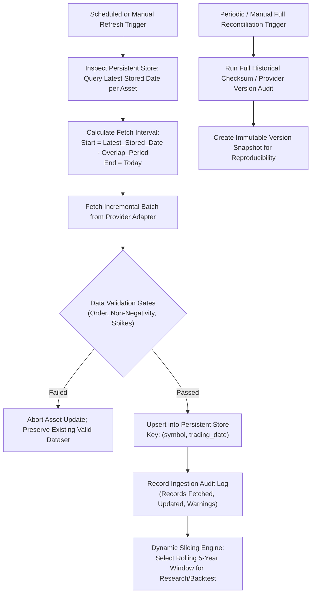

# Data Strategy & Lifecycle Specification — Quantamental AI

**Author:** Senior Quantitative Developer & Machine Learning Engineer
**Document:** Data Architecture, Universe Selection, Incremental Lifecycle & Licensing Policy
**Target Market:** Indian Equities (National Stock Exchange - NSE)
**Status:** Canonical Data Specification — Canonical Sign-off Edition (Approved Decisions)
**Version:** 1.4.0

---

## 1. Initial Asset Universe & Benchmark

Quantamental AI is designed as a **quantitative finance research and decision-support platform**. To model realistic cross-sector dynamics, non-trivial covariance structures, and macroeconomic rotation, the approved initial universe comprises **10 premier large-cap Indian equities listed on the National Stock Exchange (NSE)**, plus the **Nifty 50 Index** as the primary market benchmark.

### 1.1 Approved Ticker Catalog & Sector Diversification

| # | NSE Symbol | Company Name | Sector / Industry | Market Cap Category | Economic Role & Asset Profile | Status |
| :- | :--- | :--- | :--- | :--- | :--- | :--- |
| 1 | `RELIANCE.NS` | Reliance Industries Ltd | Energy / Conglomerate | Mega Cap | Heavyweight index constituent; exposure to refining margins, telecom, retail. | **Approved** |
| 2 | `TCS.NS` | Tata Consultancy Services Ltd | Information Technology | Mega Cap | Defensive export earner; negatively correlated with INR, sensitive to global IT spend. | **Approved** |
| 3 | `HDFCBANK.NS` | HDFC Bank Ltd | Financial Services | Mega Cap | Core banking bellwether; sensitive to systemic credit growth and RBI monetary policy. | **Approved** |
| 4 | `ICICIBANK.NS` | ICICI Bank Ltd | Financial Services | Mega Cap | Private sector banking bellwether; dynamic corporate and retail credit growth. | **Approved** |
| 5 | `INFY.NS` | Infosys Ltd | Information Technology | Mega Cap | Global IT consulting peer to TCS; high institutional liquidity. | **Approved** |
| 6 | `HINDUNILVR.NS`| Hindustan Unilever Ltd | FMCG | Mega Cap | Low-beta consumer defensive; non-cyclical cash flows and staple demand. | **Approved** |
| 7 | `LT.NS` | Larsen & Toubro Ltd | Capital Goods / Infra | Large Cap | Proxy for domestic capex, infrastructure spending, and industrial revival. | **Approved** |
| 8 | `ITC.NS` | ITC Ltd | FMCG / Conglomerate | Large Cap | High dividend yield; defensive cash flows across FMCG, paper, and hospitality. | **Approved** |
| 9 | `BHARTIARTL.NS`| Bharti Airtel Ltd | Telecommunications | Large Cap | Telecom infrastructure duopoly; recurring ARPU and digital services cash flows. | **Approved** |
| 10| `MARUTI.NS` | Maruti Suzuki India Ltd | Automotive | Large Cap | Consumer discretionary bellwether; proxy for passenger vehicle demand and input cost dynamics. | **Approved** |
| **BM** | `^NSEI` | Nifty 50 Index | Benchmark | Macro Benchmark | Primary benchmark for market regime detection, beta, and tracking error. | **Approved** |

### 1.2 Benchmark Treatment: Nifty 50 TRI vs. Price Index
- **Benchmark Role:** The Nifty 50 is strictly a **comparative benchmark**, NOT an investable asset in the initial portfolio universe.
- **Preference for Total Returns Index (TRI):** In performance measurement, equity portfolios that accumulate dividends should be benchmarked against the **Nifty 50 TRI (Total Returns Index)** subject to appropriate data licensing.
- **Documented Characteristic of Price Index (`^NSEI`):** Yahoo Finance typically provides the Nifty 50 Price Return Index (`^NSEI`), which excludes cash dividend reinvestment. Using the price index understates the total return of the benchmark by omitting cash payouts. If TRI data is not available, the benchmark is accurately labeled as the Nifty 50 Price Return Index, and the empirical difference is quantified only for specified periods where licensed TRI data is available.

### 1.3 Sector Concentration & Survivorship Bias Disclosure
- **Sector Breakdown:** Financial Services (20%), IT (20%), FMCG (20%), Energy (10%), Capital Goods (10%), Telecom (10%), Automotive (10%).
- **Survivorship Bias Limitations:** Selecting companies that are currently prominent large-cap leaders introduces survivorship bias when analyzing past periods, as these entities survived and outperformed peers over historical cycles. The architecture maintains a configurable universe schema so that historical point-in-time constituent lists can be introduced as research expands.

---

## 2. Dynamic Rolling Five-Year Research Window

The platform strictly avoids hardcoded historical date ranges (such as 2019–2024). Instead, it implements a **dynamically calculated rolling five-year research window**:

```
+-----------------------------------------------------------------------------------+
|                        DYNAMIC ROLLING WINDOW SPECIFICATION                       |
|                                                                                   |
|   1. End Date (T_end):                                                            |
|      - Dynamically resolved to the latest available completed NSE trading session. |
|      - Distinct from the system execution or data refresh timestamp.             |
|                                                                                   |
|   2. Start Date (T_start):                                                        |
|      - Dynamically calculated as: T_start = T_end - 5 Calendar Years              |
|      - Adjusted forward to the nearest subsequent active NSE trading session.     |
|                                                                                   |
|   3. Reproducibility-Supporting Controls (Immutable Manifest):                    |
|      - Every backtest and research run immutably records:                         |
|        * window_start_date & window_end_date                                      |
|        * data_snapshot_id (version hash of underlying data)                       |
|        * git_commit_sha (exact code version)                                      |
|        * dependency_lock_hash (pinned package environment)                        |
|        * model_artifact_uri (model version if ML-assisted)                        |
|        * random_seed (seed used for stochastic processes)                         |
|        * optimizer_config (solver, tolerances, max_iter, fallback)                |
|        * execution_assumptions (order type, latency)                              |
|        * cost_model_config (statutory rates, brokerage, slippage)                 |
+-----------------------------------------------------------------------------------+
```

---

## 3. Incremental Historical Data Lifecycle & Reconciliation

The rolling research window is underpinned by a **persistent, incrementally updated historical store**. The system never discards older data and never downloads full historical archives on every run.



### 3.1 Official NSE Trading Calendar Source & Update Procedure
- **Authoritative Source:** Official exchange holiday schedules published annually by the National Stock Exchange of India (NSE India) via exchange circulars.
- **Storage:** Persisted in the relational database table `nse_trading_calendar`.
- **Update Procedure:** Schedulers execute an annual ingestion routine when NSE releases the official holiday calendar for the upcoming calendar year, incorporating special sessions (e.g. Diwali Muhurat trading) and clearing holiday adjustments.

### 3.2 Persistent Historical Retention
- Historical observations are preserved indefinitely in persistent storage (local Parquet files for development; cloud storage and PostgreSQL in production).
- Observations are never deleted merely because they fall outside the current rolling five-year research window. Retaining historical data enables multi-cycle regime analysis, historical stress testing, and reproducible auditing.

### 3.3 Incremental Fetching & Recent Overlap Reconciliation
On each standard refresh:
1. The engine checks the latest successfully stored date for each asset independently.
2. The fetch range begins `Overlap_Days` (configurable, default: 5–10 trading days) prior to the latest stored date.
3. **Scope of Overlap:** This overlap reconciles **only the configured recent period** (e.g. recent settlement adjustments, dividend execution updates). It does **not** guarantee detection of retroactive corrections made months or years in the past.
4. Observations are upserted using the composite primary key `(symbol, trading_date)`. Duplicate rows are strictly prevented.

### 3.4 Periodic Broader Historical Reconciliation Strategy
To capture older historical restatements or retroactive corporate-action revisions without breaking reproducibility:
- The system supports a **periodic broader historical reconciliation** (e.g. quarterly full-history checksums or triggered version audits).
- When revised historical observations are detected, the system creates a new immutable **data snapshot version hash**.
- Existing backtest runs retain references to their original snapshot IDs, code commit SHAs, dependency locks, and optimizer settings, ensuring reproducibility-supporting audit trails.

### 3.5 Data Refresh Metadata & Traceability
Every refresh logs an immutable audit trail (`data_refresh_logs`) recording:
- Asset symbol and provider name.
- Refresh start and completion timestamps.
- Latest stored trading session date vs refresh execution timestamp.
- Counts of records fetched, updated, and rejected.
- Data-quality warnings and detected corporate actions.
- Refresh status (`SUCCESS`, `PARTIAL`, `FAILED`).

---

## 4. Configurable Missing-Data Policies & Covariance Alignment

Unconditional forward-filling is strictly removed. The platform replaces arbitrary fixed thresholds with **configurable, asset-specific data-quality thresholds** that account for listing dates, trading suspensions, legitimate non-trading periods, and provider outages:

### 4.1 Covariance Window Alignment: Listwise Default vs. Pairwise Caveat
- **Initial 10-Stock MVP Preference:** The platform **prefers a common aligned observation window using listwise-complete observations** (dropping dates where any constituent asset lacks a valid observation). This guarantees a mathematically consistent sample covariance matrix.
- **Pairwise Complete Caveat:** Estimating covariance using pairwise-complete observations evaluates asset pairs over differing observation subsets. This breaks transitivity and **can produce a non-positive-semidefinite (non-PSD) covariance matrix with negative eigenvalues**.
- **Comprehensive Higham Projection & Positive-Definite Regularization Procedure:**
  If pairwise estimation is enabled or covariance exhibits non-positive eigenvalues, the engine applies Higham's algorithm via an explicit six-step standardization, projection, regularization, and rescaling procedure:
  1. *Pre-Standardization Variance Validation & Asset Quarantine:* Validate that all diagonal variances are finite and strictly positive: $\sigma_i^2 = \boldsymbol{\Sigma}_{ii} > 0$ and $\text{isfinite}(\sigma_i^2)$. Quarantines or excludes zero-variance or non-finite assets before standardization, preventing division by zero in $\mathbf{D}^{-1/2}$.
  2. *Standardization to Correlation:* Compute $\mathbf{C} = \mathbf{D}^{-1/2} \boldsymbol{\Sigma} \mathbf{D}^{-1/2}$, where $\mathbf{D} = \text{diag}(\boldsymbol{\Sigma})$.
  3. *Higham Alternating Dykstra Projection:* Apply Higham's (2002) alternating projection algorithm to $\mathbf{C}$ to find the nearest PSD correlation matrix $\mathbf{C}_{proj}$.
  4. *Controlled Positive-Definite Regularization:* Higham's output may lie on the boundary with singular zero eigenvalues ($\lambda_{min} = 0$). Apply an eigenvalue floor $\tilde{\boldsymbol{\Lambda}} = \text{diag}(\max(\lambda_i, 10^{-7}))$ to spectral decomposition $\mathbf{V} \boldsymbol{\Lambda} \mathbf{V}^T$, forming $\tilde{\mathbf{C}} = \mathbf{V} \tilde{\boldsymbol{\Lambda}} \mathbf{V}^T$, followed by diagonal renormalization $\mathbf{C}_{reg} = \text{diag}(\tilde{\mathbf{C}})^{-1/2} \tilde{\mathbf{C}} \text{diag}(\tilde{\mathbf{C}})^{-1/2}$ to restore exact unit diagonals. This guarantees non-singular Hessians with minimal cross-correlation perturbation.
  5. *Rescaling to Covariance:* Rescale using original standard deviations: $\boldsymbol{\Sigma}_{reg} = \mathbf{D}^{1/2} \mathbf{C}_{reg} \mathbf{D}^{1/2}$, preserving original individual asset variances identically ($\boldsymbol{\Sigma}_{reg, ii} = \sigma_i^2$).
  6. *Multi-Criteria Validation & Rejection Gate:* Revalidate symmetry ($\|\boldsymbol{\Sigma}_{reg} - \boldsymbol{\Sigma}_{reg}^T\|_\infty \le 10^{-12}$), diagonal variance preservation ($\max_i |\boldsymbol{\Sigma}_{reg, ii} - \sigma_i^2| / \sigma_i^2 \le 10^{-6}$), minimum eigenvalue ($\lambda_{min} \ge 10^{-7}$), and condition number ($\kappa < 10^6$).
  - **Strict Rejection Gate:** If any validation assertion fails, **the matrix is rejected and a `CovarianceValidationError` is raised**. It is **never** silently passed to the optimizer.
  - **PSD vs. PD Distinction:** The engine explicitly distinguishes positive semi-definite ($\lambda_{min} \ge 0$, allows singular matrices) from strictly positive definite (PD: $\lambda_{min} > 0$). In portfolio optimization, strict positive definiteness ($\lambda_{min} \ge 10^{-7}$) is required.

### 4.2 Decision Hierarchy: Warnings, Exclusions & Quarantine
1. **Warning Level:** Gaps within asset-specific tolerable thresholds generate diagnostic warnings in audit logs without halting execution.
2. **Exclusion Level:** If an asset lacks sufficient aligned history for a specific estimation window, it is excluded from that specific portfolio optimization run with clear logging, rather than corrupting the multi-asset covariance matrix.
3. **Quarantine Level:** Unexplained data discontinuities, recurring zero volumes on trading days, or prolonged unexplained price freezes trigger a quarantine status requiring user inspection before inclusion.

### 4.3 Domain-Specific Missing-Data Policies

| Domain Context | Policy Specification | Technical Implementation |
| :--- | :--- | :--- |
| **Raw Storage** | Preserve unobserved dates as missing; never fill raw cache with synthetic prices. | Explicit absence in database or Parquet series. |
| **Portfolio Valuation** | Carry holding at last traded price to compute carrying value; flag asset as stale. | `is_stale=True` flag in valuation output; alert raised. |
| **Return Estimation** | Compute multi-day returns across missing intervals or omit unaligned pairs; never insert zero return. | $R_{t-k \to t} = \frac{P_t}{P_{t-k}} - 1$. |
| **Covariance / Risk** | Listwise-complete aligned window preferred; pairwise complete strictly PD-checked ($\lambda_{min} > 0$). | Documented sample size $T_{eff}$ per asset pair. |
| **ML Model Training** | Drop or mask rows with missing values; never forward-fill targets; never use `bfill`. | Chronological masking; zero future look-ahead. |
| **Backtest Execution** | If an asset did not trade on rebalance date $t$, orders in that asset are blocked; weight drifts. | No synthetic execution at stale prices; cash buffer maintained. |

---

## 5. Price Normalization & Corporate Action Schema

### 5.1 Provider-Agnostic Normalized Schema
To decouple the platform from data provider idiosyncrasies, all incoming price streams are mapped to an internal schema:

```
Internal Normalized Price Record:
├── symbol: VARCHAR(20)              # e.g., 'MARUTI.NS'
├── trading_date: DATE               # ISO 8601 date YYYY-MM-DD
├── open_nominal: NUMERIC(12, 4)     # Unadjusted nominal open (NULL if auto_adjust=True)
├── high_nominal: NUMERIC(12, 4)     # Unadjusted nominal high (NULL if auto_adjust=True)
├── low_nominal: NUMERIC(12, 4)      # Unadjusted nominal low (NULL if auto_adjust=True)
├── close_nominal: NUMERIC(12, 4)    # Unadjusted nominal close (NULL if auto_adjust=True)
├── adj_close: NUMERIC(12, 4)        # Normalized back-adjusted close (Splits + Dividends)
├── volume: BIGINT                   # Trading volume
├── split_factor: NUMERIC(8, 4)      # Split multiplier (from dedicated corporate action stream)
├── dividend_amount: NUMERIC(8, 4)   # Cash dividend paid (from dedicated corporate action stream)
├── is_stale: BOOLEAN                # Flag indicating missing/carried observation
├── data_provider: VARCHAR(50)       # e.g., 'yfinance'
├── adjustment_mode: VARCHAR(30)     # 'auto_adjust_false' or 'auto_adjust_true'
└── retrieval_timestamp: TIMESTAMPTZ # Metadata timestamp
```

### 5.2 Handling `yfinance` Modes: `auto_adjust=False` vs. `auto_adjust=True`
- **When `auto_adjust=False`:**
  - Yahoo Finance returns raw nominal prices in `Open`, `High`, `Low`, `Close`, and returns back-adjusted prices in `Adj Close`.
  - The pipeline maps nominal fields to `open_nominal`, `high_nominal`, `low_nominal`, `close_nominal`, and maps `Adj Close` to `adj_close`.
- **When `auto_adjust=True`:**
  - Yahoo Finance returns back-adjusted prices in `Open`, `High`, `Low`, `Close` and omits nominal prices.
  - The engine explicitly states that nominal OHLC is **not available** in that response.
  - **Prohibition:** The engine **never** populates nominal fields with adjusted prices. Nominal fields remain `NULL`.
- **Corporate Action Treatment:**
  - `split_factor` and `dividend_amount` are **never** inferred from adjusted OHLC alone. They are populated strictly from dedicated corporate action streams or verified regulatory circulars.
- **Missing Field Behavior:**
  - If expected provider fields are missing (e.g. null `Adj Close` when `auto_adjust=False`), the ingestion gate raises a validation error, rejects the corrupted record, and records a diagnostic warning in `data_refresh_logs`.

---

## 6. Two-Tier Storage Architecture

```
+---------------------------------------------------------------------------------+
|                               STORAGE ARCHITECTURE                              |
|                                                                                 |
|   Tier 1: Columnar Time-Series Store (Local Parquet for Dev / S3 for Prod)     |
|   - Path: storage/parquet/{symbol}.parquet                                      |
|   - Vectorized reads benchmark target: < 10 ms for 5-year series on dev machine.|
|                                                                                 |
|   Tier 2: Relational Audit & Persistence Layer (Supabase PostgreSQL)            |
|   - Tables: assets, daily_prices, data_refresh_logs, portfolios, backtest_runs. |
|   - Manages relational links, refresh audit metadata, and experiment configs.   |
+---------------------------------------------------------------------------------+
```

---

## 7. Data Licensing, Permissions & Compliance

Quantamental AI treats all data permissions with legal and regulatory diligence:

- **General Principle:** Usage of all financial market data is strictly subject to provider terms of service, exchange licensing, and applicable law. The project does not present informal scraper usage as a definitive legal right.
- **Commercial Use & Redistribution:** Any commercial deployment, public data serving, or data redistribution requires a formal review of applicable provider terms, exchange licensing, and law.
- **Yahoo Finance (`yfinance`):** Utilized strictly for personal, individual, non-commercial research exploration.
- **NSE Bhavcopy:** Daily closing archives published by NSE India. Any commercial exploitation, redistribution, or data repackaging requires formal review against applicable exchange licensing and terms.
- **Production Path (Licensed Broker APIs):** For commercial deployment or automated execution, the platform transitions to regulated broker APIs (**Zerodha Kite Connect**, **Upstox API**, or **TrueData**), which provide licensed market access.
